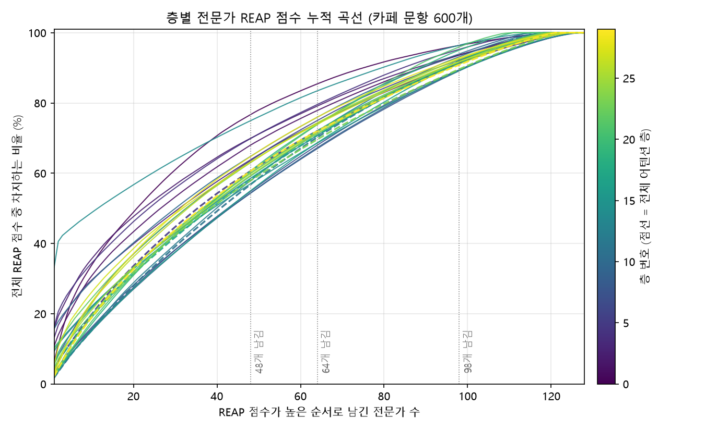
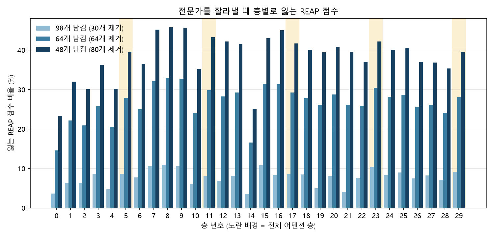

# 4b단계: 전문가 REAP 통계 요약 (가지치기 전)

- 데이터: 카페 보정 세트 600문항(`data/calib_cafe.jsonl`), 모델 `gemma-4-26B-A4B-it` 원본(BF16 → float32 계산), CPU에서 층 단위 실행
- 계산 토큰 129,734개(접두사 트리, 따로 돌리면 2,118,287개). 가중치: 고정 프롬프트(시스템 지시문 + 도구 설명, 3,466토큰)는 전체 합쳐 한 번, 문항별 부분(평균 64.5토큰)은 문항마다 한 번.
- REAP 점수: 전문가로 보내진 토큰들의 '게이트 값 × 전문가 출력 노름' 평균. 층마다 이 점수가 낮은 전문가부터 잘라낸다고 가정한다(모든 층에서 같은 수를 남김).
- 아직 아무것도 잘라내지 않았다. 아래의 '제거 대상'은 계획일 뿐이다.

용어:
- **REAP 점수 비율:** 층 안의 전문가별 REAP 점수 합 중 일부 전문가가 차지하는 비율.
- **기여 비율:** 모든 토큰에 대해 '게이트 × 노름'을 더한 값 중 비율. 자주 쓰이는 전문가일수록 크다.
- **재배정 토큰 비율:** 잘라낸 전문가로 가던 토큰 배정의 비율. 잘라낸 뒤에는 이 토큰들이 다른 전문가로 간다.

## 전체 요약

| 남기는 전문가 | 제거 (층당) | 잃는 REAP 점수 (전체) | 잃는 기여 (전체) | 평균 재배정 토큰 | 제거 대상 중 고정 프롬프트가 쓰던 전문가 | 그중 고정 프롬프트만 쓰던 전문가 | 제거 대상 중 한 번도 안 쓰인 전문가 |
|---:|---:|---:|---:|---:|---:|---:|---:|
| 98 | 30 | 7.3% | 3.5% | 9.6% | 663 / 900 | 80 | 213 |
| 64 | 64 | 25.4% | 17.9% | 32.5% | 1662 / 1920 | 159 | 213 |
| 48 | 80 | 36.7% | 28.8% | 46.7% | 2133 / 2400 | 197 | 213 |

## 1. 층별 전문가 사용 현황

| 층 | 종류 | 한 번도 안 쓰임 | 고정 프롬프트만 | 문항별 부분만 | 둘 다 |
|---:|---|---:|---:|---:|---:|
| 0 | 슬라이딩 | 6 | 13 | 2 | 107 |
| 1 | 슬라이딩 | 7 | 2 | 0 | 119 |
| 2 | 슬라이딩 | 5 | 3 | 0 | 120 |
| 3 | 슬라이딩 | 3 | 6 | 0 | 119 |
| 4 | 슬라이딩 | 7 | 15 | 0 | 106 |
| 5 | 전체 | 6 | 18 | 2 | 102 |
| 6 | 슬라이딩 | 7 | 9 | 3 | 109 |
| 7 | 슬라이딩 | 2 | 12 | 0 | 114 |
| 8 | 슬라이딩 | 2 | 9 | 0 | 117 |
| 9 | 슬라이딩 | 1 | 6 | 3 | 118 |
| 10 | 슬라이딩 | 13 | 12 | 4 | 99 |
| 11 | 전체 | 10 | 11 | 4 | 103 |
| 12 | 슬라이딩 | 10 | 7 | 2 | 109 |
| 13 | 슬라이딩 | 9 | 8 | 0 | 111 |
| 14 | 슬라이딩 | 11 | 8 | 2 | 107 |
| 15 | 슬라이딩 | 2 | 5 | 0 | 121 |
| 16 | 슬라이딩 | 10 | 7 | 7 | 104 |
| 17 | 전체 | 6 | 22 | 1 | 99 |
| 18 | 슬라이딩 | 7 | 12 | 3 | 106 |
| 19 | 슬라이딩 | 17 | 12 | 5 | 94 |
| 20 | 슬라이딩 | 8 | 16 | 4 | 100 |
| 21 | 슬라이딩 | 17 | 15 | 6 | 90 |
| 22 | 슬라이딩 | 9 | 11 | 7 | 101 |
| 23 | 전체 | 4 | 11 | 2 | 111 |
| 24 | 슬라이딩 | 5 | 12 | 0 | 111 |
| 25 | 슬라이딩 | 4 | 12 | 2 | 110 |
| 26 | 슬라이딩 | 8 | 12 | 3 | 105 |
| 27 | 슬라이딩 | 3 | 13 | 0 | 112 |
| 28 | 슬라이딩 | 7 | 16 | 3 | 102 |
| 29 | 전체 | 7 | 13 | 4 | 104 |
| **합계** | | **213** | **328** | **69** | **3230** |

## 2. REAP 점수 분포와 집중도

상위 N개 전문가가 차지하는 REAP 점수 비율. '유효 전문가 수'는 점수 분포의 엔트로피로 잰 값으로, 작을수록 점수가 소수에게 몰려 있다.

| 층 | 상위 32 | 상위 64 | 상위 98 | 유효 전문가 수 | 1위 전문가 (점수 비율) |
|---:|---:|---:|---:|---:|---|
| 0 | 63.1% | 85.4% | 96.4% | 77 | 71번 (6.3%) |
| 1 | 55.1% | 77.9% | 93.6% | 84 | 39번 (10.7%) |
| 2 | 58.4% | 79.1% | 93.7% | 73 | 65번 (15.7%) |
| 3 | 50.9% | 74.3% | 91.3% | 85 | 42번 (13.1%) |
| 4 | 57.5% | 79.5% | 95.3% | 71 | 11번 (16.3%) |
| 5 | 46.7% | 72.1% | 91.3% | 105 | 103번 (3.8%) |
| 6 | 49.4% | 75.0% | 92.3% | 99 | 52번 (5.8%) |
| 7 | 40.1% | 68.0% | 89.4% | 114 | 67번 (2.2%) |
| 8 | 40.1% | 67.0% | 89.1% | 114 | 123번 (3.0%) |
| 9 | 39.5% | 67.3% | 89.4% | 115 | 18번 (2.4%) |
| 10 | 51.8% | 75.9% | 94.0% | 78 | 47번 (15.7%) |
| 11 | 41.2% | 70.2% | 92.0% | 109 | 70번 (1.7%) |
| 12 | 41.9% | 71.8% | 93.1% | 107 | 45번 (1.8%) |
| 13 | 44.9% | 70.8% | 91.8% | 97 | 109번 (9.2%) |
| 14 | 65.2% | 83.4% | 96.4% | 37 | 60번 (33.1%) |
| 15 | 44.0% | 68.6% | 89.2% | 99 | 106번 (10.3%) |
| 16 | 39.6% | 68.6% | 91.7% | 110 | 63번 (2.1%) |
| 17 | 43.8% | 70.8% | 91.4% | 107 | 112번 (4.6%) |
| 18 | 45.5% | 72.1% | 91.5% | 102 | 52번 (5.8%) |
| 19 | 44.7% | 73.9% | 95.0% | 101 | 50번 (1.9%) |
| 20 | 44.5% | 71.2% | 91.9% | 103 | 75번 (5.4%) |
| 21 | 44.7% | 73.8% | 95.9% | 100 | 15번 (2.2%) |
| 22 | 49.4% | 74.2% | 92.5% | 92 | 83번 (9.7%) |
| 23 | 44.3% | 69.6% | 89.6% | 110 | 3번 (2.4%) |
| 24 | 45.8% | 71.8% | 91.7% | 106 | 8번 (2.6%) |
| 25 | 45.1% | 71.4% | 91.1% | 106 | 103번 (3.9%) |
| 26 | 49.0% | 74.3% | 92.5% | 101 | 68번 (3.4%) |
| 27 | 50.2% | 73.9% | 91.8% | 97 | 25번 (5.4%) |
| 28 | 50.8% | 76.0% | 92.8% | 99 | 84번 (3.1%) |
| 29 | 45.9% | 72.0% | 90.8% | 107 | 10번 (2.2%) |

## 3. 남기는 수별 제거 계획

### 98개 남김 (층당 30개 제거)

| 층 | 잃는 REAP 점수 | 잃는 기여 | 재배정 토큰 | 제거 대상 중 고정 프롬프트 사용 | 그중 고정만 | 한 번도 안 쓰임 |
|---:|---:|---:|---:|---:|---:|---:|
| 0 | 3.6% | 0.8% | 4.2% | 23 | 4 | 6 |
| 1 | 6.4% | 2.5% | 7.9% | 23 | 2 | 7 |
| 2 | 6.3% | 1.6% | 5.9% | 25 | 1 | 5 |
| 3 | 8.7% | 4.3% | 10.8% | 27 | 2 | 3 |
| 4 | 4.7% | 23.1% | 67.3% | 23 | 4 | 7 |
| 5 | 8.7% | 2.4% | 5.9% | 23 | 6 | 6 |
| 6 | 7.7% | 1.8% | 3.9% | 20 | 3 | 7 |
| 7 | 10.6% | 6.6% | 13.2% | 28 | 5 | 2 |
| 8 | 10.9% | 6.5% | 13.2% | 28 | 2 | 2 |
| 9 | 10.6% | 2.1% | 5.1% | 26 | 1 | 1 |
| 10 | 6.0% | 5.5% | 11.7% | 16 | 3 | 13 |
| 11 | 8.0% | 5.1% | 9.4% | 19 | 2 | 10 |
| 12 | 6.9% | 3.9% | 7.7% | 18 | 2 | 10 |
| 13 | 8.2% | 4.5% | 7.3% | 21 | 4 | 9 |
| 14 | 3.6% | 4.7% | 9.9% | 18 | 2 | 11 |
| 15 | 10.8% | 10.0% | 18.3% | 28 | 2 | 2 |
| 16 | 8.3% | 6.0% | 12.2% | 17 | 1 | 10 |
| 17 | 8.6% | 5.0% | 11.6% | 23 | 5 | 6 |
| 18 | 8.5% | 3.7% | 9.0% | 23 | 1 | 7 |
| 19 | 5.0% | 1.1% | 2.8% | 11 | 2 | 17 |
| 20 | 8.1% | 0.6% | 1.7% | 22 | 4 | 8 |
| 21 | 4.1% | 0.3% | 0.9% | 11 | 3 | 17 |
| 22 | 7.5% | 1.1% | 3.1% | 20 | 0 | 9 |
| 23 | 10.4% | 1.6% | 4.5% | 26 | 5 | 4 |
| 24 | 8.3% | 1.1% | 3.4% | 25 | 2 | 5 |
| 25 | 8.9% | 1.6% | 4.6% | 26 | 4 | 4 |
| 26 | 7.5% | 0.9% | 2.8% | 22 | 2 | 8 |
| 27 | 8.2% | 3.0% | 8.5% | 27 | 1 | 3 |
| 28 | 7.2% | 0.7% | 2.9% | 23 | 4 | 7 |
| 29 | 9.2% | 8.9% | 18.9% | 21 | 1 | 7 |
| **전체** | **7.3%** | **3.5%** | 9.6% (평균) | **663** | **80** | **213** |

층별 제거 대상 전문가 번호 (98개 남김)

- 0층: 7, 16, 19-20, 23, 28, 37, 39-40, 42-44, 49, 57-58, 63, 70, 82, 90, 93, 98, 103, 110, 113, 117-119, 121, 123, 126
- 1층: 5, 12, 17, 19, 22-23, 28, 30-32, 43, 45-46, 54, 58, 63, 68, 75, 85, 87-88, 93, 95, 97-98, 100-101, 119, 123, 126
- 2층: 1, 4, 7, 17-18, 20, 22, 25, 30, 35, 37, 40, 42, 45, 50-51, 54, 68, 71, 84, 89-90, 94, 96, 101-102, 105, 108, 113, 119
- 3층: 5, 7, 10-11, 17-18, 21, 25, 27, 37, 50, 55, 66, 70-71, 73, 78, 82, 86, 88, 95-96, 101-102, 107, 115, 118, 121, 123-124
- 4층: 1, 6, 8, 12-13, 23, 27, 29, 31, 41, 45, 47, 54-55, 59-61, 64-65, 74, 77, 86, 89, 96, 106-107, 115, 119, 121, 123
- 5층: 1-2, 9, 12-13, 22-24, 32, 35, 40, 45, 61, 63, 71, 73-74, 82, 86, 89, 91, 95, 97, 99, 102, 104, 111-112, 120, 125
- 6층: 0-1, 3, 8, 13, 16, 23, 25-26, 32, 42-43, 45, 54-55, 57, 76-78, 84, 87, 92, 97-99, 101-102, 124-125, 127
- 7층: 3, 6, 9, 11, 19-20, 22, 30, 34-35, 39, 50, 57, 60, 62, 65, 69, 73, 83-84, 92, 94, 97, 100, 103, 108, 115, 117, 121, 125
- 8층: 0-1, 9-10, 15, 19, 26, 30, 33, 35, 39, 54-55, 58, 60, 64-65, 70, 77, 83-86, 90, 96-97, 100, 102, 117, 124
- 9층: 0, 6-7, 13, 15, 19, 26, 29, 32-33, 35-37, 43, 45, 51, 63-64, 70, 74-76, 83, 86, 89, 92, 105, 111, 121, 124
- 10층: 1, 8, 15, 19, 23-25, 28, 37, 44, 50, 52, 61, 67, 71-72, 74, 78-79, 86, 89, 98, 105, 107, 109-110, 120, 123, 126-127
- 11층: 1, 9, 16, 25, 27, 32, 36, 42, 49, 55, 60, 63, 67, 69, 75, 89, 93, 95-97, 99, 112-114, 116-117, 121, 123, 125-126
- 12층: 3-4, 10-11, 13, 15, 19, 22, 35, 48-49, 54, 56, 62, 69, 72-74, 81, 85, 92, 97, 100, 103-104, 110, 114, 117, 121, 124
- 13층: 13-14, 17, 20-21, 23-24, 27-28, 30, 36-38, 43, 48, 55, 61, 63, 65, 78, 87, 91, 97, 99, 101, 103, 110, 112, 114, 116
- 14층: 0-2, 5, 9-10, 15-16, 24-25, 38, 41, 45, 47, 50, 52, 58-59, 65, 68, 70, 88, 91-92, 99, 106, 109, 111, 116, 125
- 15층: 2, 6, 9, 12-13, 19, 22, 36, 43, 51, 53, 59-60, 69-70, 75, 77, 81-82, 94, 96, 107, 112-113, 115-118, 125-126
- 16층: 1, 9, 15, 18, 20, 29, 32, 35-36, 52-53, 55-56, 58, 60-62, 64, 66, 70, 77, 85, 87, 91, 97, 99-100, 103, 109, 121
- 17층: 3, 8-9, 13, 21, 24-25, 30, 34, 37, 40-41, 44-45, 53, 59, 62, 65, 67, 70, 76, 78-79, 100, 105, 109, 117, 119, 126-127
- 18층: 0, 2-3, 7, 9, 13, 17, 20, 27, 29, 34-35, 41, 45, 50, 55, 57, 60, 68, 73, 77, 84, 89, 104, 106-108, 118, 125-126
- 19층: 0, 2-3, 8, 17, 31, 49, 53, 61, 65, 67, 72-73, 76-77, 88-89, 91, 93, 96, 98, 100, 105, 108, 113, 119, 122-123, 126-127
- 20층: 0, 7, 14-15, 24, 31, 36, 41, 47-49, 53, 56, 61, 68-71, 74, 86-87, 90, 95, 97, 101, 109-110, 113-114, 125
- 21층: 0, 6, 8, 18-19, 21, 24, 29, 31, 43, 47, 49, 51, 69, 75, 81, 88, 90, 93, 96, 99, 102, 111-112, 114-115, 118, 121, 123, 125
- 22층: 3-5, 11-12, 18, 22, 30-31, 36, 43, 46, 50, 52, 55-56, 71, 74-75, 80, 86-88, 97-99, 105, 111-112, 117
- 23층: 2, 6, 14-16, 19-20, 22, 24-25, 27-28, 32, 34, 43-44, 48, 51, 53, 59, 64, 67-68, 75, 96, 98, 107, 113, 117, 121
- 24층: 2-3, 6-7, 15-16, 20, 26-27, 37, 41, 52-53, 71, 82, 84-85, 90-92, 94-95, 97, 103, 106-107, 114, 117, 123-124
- 25층: 0, 8, 11-14, 18, 20, 23, 31, 34, 43, 47, 51, 53, 62, 64, 71, 73, 76, 90, 96, 99, 107-108, 112, 116-117, 120, 123
- 26층: 2-3, 13, 16, 22, 25, 28, 30-32, 38, 41-42, 67, 73, 75-76, 83-84, 91, 96, 100, 103-104, 108, 119, 121-122, 126-127
- 27층: 10-11, 17, 19, 31-32, 35, 39-40, 42, 49, 52, 59, 69-70, 77, 79, 83, 86, 88, 95, 98-99, 101, 104-105, 108-109, 112, 116
- 28층: 5-6, 10-12, 20-21, 24, 30, 41, 43, 45, 47, 52, 54-55, 60, 67, 69, 76, 78, 80, 82, 87, 95, 98, 101, 108, 120, 126
- 29층: 1, 5, 8, 12, 15, 17-18, 32, 39, 42-43, 46, 50, 53, 55, 61-62, 64, 69-70, 73, 79, 81, 88, 104, 107, 109, 118-119, 122

### 64개 남김 (층당 64개 제거)

| 층 | 잃는 REAP 점수 | 잃는 기여 | 재배정 토큰 | 제거 대상 중 고정 프롬프트 사용 | 그중 고정만 | 한 번도 안 쓰임 |
|---:|---:|---:|---:|---:|---:|---:|
| 0 | 14.6% | 7.1% | 22.3% | 56 | 6 | 6 |
| 1 | 22.1% | 14.4% | 32.0% | 57 | 2 | 7 |
| 2 | 20.9% | 12.5% | 29.8% | 59 | 1 | 5 |
| 3 | 25.7% | 13.5% | 26.4% | 61 | 3 | 3 |
| 4 | 20.5% | 35.7% | 77.8% | 57 | 7 | 7 |
| 5 | 27.9% | 13.4% | 25.1% | 57 | 10 | 6 |
| 6 | 25.0% | 22.3% | 35.6% | 54 | 5 | 7 |
| 7 | 32.0% | 21.3% | 33.6% | 62 | 9 | 2 |
| 8 | 33.0% | 31.1% | 43.3% | 62 | 3 | 2 |
| 9 | 32.7% | 24.6% | 36.4% | 60 | 2 | 1 |
| 10 | 24.1% | 21.9% | 38.1% | 47 | 5 | 13 |
| 11 | 29.8% | 35.2% | 47.9% | 52 | 6 | 10 |
| 12 | 28.2% | 40.3% | 57.6% | 52 | 3 | 10 |
| 13 | 29.2% | 31.4% | 42.5% | 55 | 5 | 9 |
| 14 | 16.6% | 29.6% | 44.1% | 52 | 6 | 11 |
| 15 | 31.4% | 32.7% | 46.4% | 62 | 3 | 2 |
| 16 | 31.4% | 31.5% | 44.9% | 50 | 3 | 10 |
| 17 | 29.2% | 18.5% | 32.3% | 57 | 10 | 6 |
| 18 | 27.9% | 15.8% | 29.2% | 55 | 3 | 7 |
| 19 | 26.1% | 17.5% | 29.2% | 44 | 4 | 17 |
| 20 | 28.8% | 12.8% | 21.1% | 54 | 8 | 8 |
| 21 | 26.2% | 12.6% | 20.6% | 44 | 5 | 17 |
| 22 | 25.8% | 6.7% | 15.2% | 51 | 3 | 9 |
| 23 | 30.4% | 6.8% | 15.1% | 59 | 7 | 4 |
| 24 | 28.2% | 8.5% | 17.0% | 59 | 5 | 5 |
| 25 | 28.6% | 12.8% | 22.9% | 59 | 7 | 4 |
| 26 | 25.7% | 7.9% | 16.6% | 54 | 5 | 8 |
| 27 | 26.1% | 8.3% | 17.6% | 61 | 8 | 3 |
| 28 | 24.0% | 3.5% | 9.7% | 56 | 12 | 7 |
| 29 | 28.0% | 24.9% | 43.5% | 54 | 3 | 7 |
| **전체** | **25.4%** | **17.9%** | 32.5% (평균) | **1662** | **159** | **213** |

층별 제거 대상 전문가 번호 (64개 남김)

- 0층: 0, 4, 7-8, 14, 16, 18-20, 23, 25, 28, 31, 33-34, 37-40, 42-45, 47, 49-51, 53, 55, 57-59, 63, 66-68, 70, 74-77, 80, 82, 88-91, 93-94, 98, 103-104, 107, 110, 113-114, 117-121, 123, 125-126
- 1층: 3, 5, 8, 10-12, 14-15, 17, 19, 21-24, 26, 28-32, 38, 41, 43, 45-46, 49, 53-54, 58, 60, 62-65, 67-68, 70-72, 75-76, 78-79, 81-82, 84-88, 93-95, 97-98, 100-101, 116, 119-123, 126
- 2층: 1-2, 4, 7, 9, 17-18, 20, 22-26, 29-30, 34-35, 37-38, 40-42, 44-45, 50-56, 58, 62-64, 68, 70-72, 76-77, 81, 83-85, 87, 89-91, 94-96, 101-103, 105, 108, 110, 112-113, 119, 122, 124-125
- 3층: 5-12, 14, 17-19, 21-23, 25, 27, 33, 36-39, 41, 43, 48, 50, 55, 61-63, 66, 69-71, 73-74, 78-80, 82, 86, 88, 93, 95-97, 101-104, 106-107, 110-111, 115-116, 118, 121-127
- 4층: 1, 3-6, 8, 12-13, 15-16, 18, 20, 22-25, 27, 29-31, 36, 41, 43, 45, 47-48, 50, 52-55, 59-61, 63-65, 67, 69, 71, 74, 76-77, 79, 82-83, 86, 89, 92, 94, 96-97, 104, 106-107, 111, 114-115, 119, 121-123, 125-126
- 5층: 1-2, 9, 12-13, 18-20, 22-24, 28, 32-33, 35, 38, 40-42, 44-45, 47-48, 50, 54, 59, 61-65, 67-74, 76-77, 82, 86, 89, 91, 93, 95, 97, 99, 102, 104, 107-108, 111-113, 115, 118-121, 124-126
- 6층: 0-1, 3-4, 8-13, 16-18, 20, 23, 25-26, 28, 30, 32-33, 35, 37-38, 42-43, 45, 51, 53-55, 57, 61, 65, 67-69, 76-78, 82, 84-87, 91-92, 94, 97-102, 104, 106, 108, 119-121, 124-127
- 7층: 0, 2-3, 5-6, 8-11, 14-15, 18-20, 22, 24, 27, 30, 34-35, 39-40, 43, 46-47, 50, 52-53, 56-58, 60-62, 64-65, 69-70, 73, 75-76, 82-84, 88, 92, 94-97, 100, 102-103, 105, 108, 110, 113, 115, 117, 120-122, 124-125
- 8층: 0-1, 6, 8-11, 14-17, 19, 26, 29-30, 33, 35, 39-40, 44, 46-48, 50-51, 53-55, 58, 60-61, 63-65, 68, 70-71, 73, 75, 77-78, 81, 83-86, 90, 93-94, 96-97, 100-102, 107, 112, 115, 117-118, 121-122, 124-125, 127
- 9층: 0, 4, 6-7, 9, 13, 15, 19, 22-26, 29-33, 35-38, 40, 43, 45-48, 50-51, 53, 55-58, 63-64, 68-70, 73-77, 81, 83, 86, 89, 91-92, 97, 99-100, 102-103, 105-106, 111, 114, 117, 121, 124, 127
- 10층: 0-1, 4-5, 8, 10-11, 14-15, 17, 19-21, 23-25, 27-28, 34, 37-38, 44, 48, 50, 52, 55, 57, 61-62, 64-68, 71-72, 74, 77-79, 83, 86, 88-89, 92, 95, 97-99, 102-103, 105, 107, 109-110, 113, 115, 120, 122-127
- 11층: 0-1, 4, 6, 9-10, 13-20, 22-23, 25-27, 30, 32-33, 36, 41-43, 45, 49-50, 54-55, 57-58, 60, 63, 67-69, 71-72, 74-75, 81, 83-84, 86, 89, 93, 95-97, 99, 105, 109, 112-117, 121, 123, 125-126
- 12층: 3-5, 7, 9-11, 13, 15-20, 22, 32, 35, 40, 46-50, 53-56, 59, 62, 64, 69, 71-78, 80-85, 91-92, 95, 97-98, 100-101, 103-104, 107-111, 114, 117-118, 121, 124
- 13층: 2-3, 7-8, 10, 13-14, 17, 20-25, 27-30, 32-33, 35-38, 40, 42-43, 48, 53-56, 60-61, 63-65, 71, 73, 78, 81, 85, 87, 90-93, 96-97, 99-101, 103, 105-107, 110-112, 114, 116, 120-121, 124
- 14층: 0-2, 5, 7-11, 14-16, 21, 24-25, 31, 33, 35, 38-42, 44-45, 47-48, 50, 52, 58-59, 65-66, 68, 70, 74-75, 77, 83-84, 86-89, 91-93, 95, 99, 104, 106-109, 111-113, 116, 119, 121-122, 125-127
- 15층: 2, 5-6, 8-9, 11-13, 17, 19, 21-24, 26, 29, 31, 33, 36, 38, 41, 43-44, 51-54, 58-60, 62, 66, 68-71, 73, 75, 77, 79, 81-82, 88-89, 91, 94, 96-98, 103, 105, 107, 109-110, 112-113, 115-118, 122-123, 125-126
- 16층: 1, 5-9, 15, 17-20, 23, 25, 27, 29, 32-36, 38, 40, 45-46, 48, 52-53, 55-58, 60-62, 64-66, 68-71, 77, 85-89, 91-92, 96-97, 99-101, 103, 106, 109, 112-114, 116, 120-122
- 17층: 0-1, 3-4, 6-9, 11-13, 18, 21, 23-27, 30, 34, 36-37, 40-41, 44-46, 51, 53, 59, 62-67, 70, 72, 76, 78-79, 81-82, 85, 89, 92-93, 96, 100-101, 103, 105, 109-110, 113-114, 116-120, 122, 126-127
- 18층: 0, 2-4, 6-11, 13, 15-18, 20, 22, 27, 29, 34-35, 37, 41, 45-46, 48, 50-51, 55, 57-62, 65, 67-68, 70, 73-75, 77, 80-84, 89, 101-104, 106-110, 115-116, 118, 124-126
- 19층: 0-3, 8-9, 17, 21, 26-27, 31, 36, 38-41, 47-49, 52-53, 56-58, 61, 65-67, 71-73, 75-77, 79-80, 82-84, 86-91, 93, 96-98, 100, 104-106, 108, 113-114, 116, 119, 121-124, 126-127
- 20층: 0-1, 4-5, 7, 9, 14-16, 19, 21-24, 31, 36, 38-39, 41, 43-44, 46-50, 52-53, 56, 61, 63, 65-71, 74, 77, 81, 83-84, 86-87, 90-91, 94-95, 97, 99, 101, 105, 107-110, 113-114, 117, 122-125
- 21층: 0, 4, 6, 8-9, 14, 16, 18-19, 21, 24, 27, 29, 31, 35-36, 38-41, 43-45, 47, 49, 51-52, 55, 59-60, 67-69, 75-77, 80-84, 86-88, 90, 92-96, 99, 102, 106, 108, 111-112, 114-115, 118, 121, 123-125, 127
- 22층: 3-6, 8, 11-12, 17-18, 20-22, 25-26, 29-34, 36, 41, 43, 45-47, 50-52, 55-56, 58-59, 61, 64, 68, 71, 73-75, 80, 86-89, 92, 94-95, 97-99, 101, 105-106, 108, 111-112, 114-117, 121, 124, 126
- 23층: 2, 6, 8-11, 14-16, 18-20, 22, 24-25, 27-28, 32, 34-35, 41, 43-44, 46, 48, 51, 53, 55-59, 64, 67-68, 70-71, 73, 75, 79-80, 83-84, 93-96, 98-100, 102-103, 105, 107, 111-113, 115-117, 120-121, 125, 127
- 24층: 1-3, 6-7, 9, 11-12, 15-17, 20, 26-27, 32, 35, 37-39, 41, 43-44, 47, 52-56, 58, 60-61, 64, 68, 71, 81-82, 84-87, 89-92, 94-98, 100, 102-103, 106-107, 112, 114-118, 120, 123-125
- 25층: 0, 3-5, 7-14, 18-20, 23-24, 26, 29, 31, 34-35, 38, 42-43, 45-47, 49-51, 53, 55, 62, 64-65, 67-68, 71, 73-74, 76, 88-91, 94, 96, 99, 101, 104, 107-110, 112, 116-117, 120-123, 125, 127
- 26층: 2-3, 11-13, 15-17, 20, 22, 24-25, 28, 30-36, 38-39, 41-42, 50, 57, 61, 63-64, 66-67, 69, 73-77, 81-84, 86, 89-93, 95-96, 100, 103-105, 108-109, 112, 118-119, 121-124, 126-127
- 27층: 0, 10-11, 15-19, 22, 24, 26, 29-32, 34-35, 39-40, 42, 44, 47, 49, 52, 54-55, 59-60, 69-74, 77, 79, 81-83, 86-88, 90, 95, 98-101, 104-110, 112, 114-116, 118, 120, 122-123, 127
- 28층: 5-6, 10-12, 14, 18-22, 24, 30, 33, 41-47, 51-52, 54-56, 60, 62, 64, 66-67, 69, 71, 73-78, 80, 82, 86-87, 89, 91, 94-99, 101-103, 108-109, 111, 116, 119-120, 123, 125-127
- 29층: 0-1, 5-6, 8, 11-12, 14-18, 26, 28-29, 32-33, 37, 39-40, 42-44, 46, 49-53, 55, 60-65, 67-71, 73-75, 78-79, 81, 83, 85, 88-89, 102, 104, 107, 109, 116-119, 122-123, 125-127

### 48개 남김 (층당 80개 제거)

| 층 | 잃는 REAP 점수 | 잃는 기여 | 재배정 토큰 | 제거 대상 중 고정 프롬프트 사용 | 그중 고정만 | 한 번도 안 쓰임 |
|---:|---:|---:|---:|---:|---:|---:|
| 0 | 23.3% | 15.5% | 37.3% | 72 | 7 | 6 |
| 1 | 32.0% | 20.9% | 42.5% | 73 | 2 | 7 |
| 2 | 30.1% | 20.4% | 43.1% | 75 | 1 | 5 |
| 3 | 36.2% | 21.5% | 36.9% | 77 | 3 | 3 |
| 4 | 30.2% | 40.0% | 80.5% | 73 | 8 | 7 |
| 5 | 39.4% | 28.6% | 46.2% | 73 | 13 | 6 |
| 6 | 36.5% | 40.8% | 57.8% | 70 | 6 | 7 |
| 7 | 45.2% | 35.9% | 48.8% | 78 | 9 | 2 |
| 8 | 45.7% | 42.0% | 54.3% | 78 | 4 | 2 |
| 9 | 45.7% | 33.4% | 46.5% | 76 | 3 | 1 |
| 10 | 35.2% | 32.8% | 51.2% | 63 | 7 | 13 |
| 11 | 43.2% | 49.7% | 62.9% | 66 | 8 | 10 |
| 12 | 42.1% | 56.9% | 72.9% | 68 | 3 | 10 |
| 13 | 41.5% | 57.0% | 68.5% | 71 | 6 | 9 |
| 14 | 25.1% | 45.2% | 60.4% | 68 | 6 | 11 |
| 15 | 43.0% | 47.5% | 62.0% | 78 | 3 | 2 |
| 16 | 45.0% | 46.5% | 59.6% | 65 | 3 | 10 |
| 17 | 41.7% | 34.1% | 50.9% | 73 | 12 | 6 |
| 18 | 40.1% | 20.8% | 35.7% | 70 | 4 | 7 |
| 19 | 39.4% | 31.3% | 44.9% | 59 | 6 | 17 |
| 20 | 40.9% | 27.3% | 40.6% | 69 | 9 | 8 |
| 21 | 39.6% | 17.2% | 26.6% | 59 | 9 | 17 |
| 22 | 37.0% | 12.9% | 25.9% | 66 | 5 | 9 |
| 23 | 42.2% | 12.2% | 23.7% | 75 | 8 | 4 |
| 24 | 40.1% | 14.1% | 25.3% | 75 | 7 | 5 |
| 25 | 40.6% | 20.6% | 33.4% | 75 | 10 | 4 |
| 26 | 37.0% | 19.5% | 34.9% | 70 | 8 | 8 |
| 27 | 36.8% | 22.7% | 37.3% | 77 | 9 | 3 |
| 28 | 35.3% | 18.5% | 34.3% | 72 | 15 | 7 |
| 29 | 39.4% | 36.1% | 57.0% | 69 | 3 | 7 |
| **전체** | **36.7%** | **28.8%** | 46.7% (평균) | **2133** | **197** | **213** |

층별 제거 대상 전문가 번호 (48개 남김)

- 0층: 0-4, 7-8, 12, 14, 16, 18-20, 23, 25, 28, 31-34, 36-40, 42-45, 47-53, 55, 57-59, 63, 66-68, 70, 72-77, 80-82, 84-85, 88-91, 93-95, 98, 103-104, 107, 110, 112-114, 117-121, 123, 125-127
- 1층: 3-5, 8, 10-12, 14-19, 21-24, 26-32, 38, 41-43, 45-46, 49, 51-54, 58, 60, 62-65, 67-68, 70-76, 78-82, 84-90, 93-101, 113, 116, 119-123, 126-127
- 2층: 0-4, 7-9, 15, 17-18, 20, 22-26, 29-30, 34-35, 37-38, 40-42, 44-45, 49-56, 58, 60, 62-64, 68, 70-72, 76-77, 80-81, 83-85, 87-91, 94-97, 99-105, 108, 110, 112-113, 115-116, 119, 121-122, 124-125, 127
- 3층: 0, 4-12, 14, 17-19, 21-23, 25-27, 30, 33-34, 36-41, 43, 48, 50, 55, 57, 61-66, 69-75, 78-82, 85-88, 93-97, 101-104, 106-107, 110-112, 115-116, 118, 121-127
- 4층: 0-1, 3-6, 8, 12-13, 15-16, 18, 20-27, 29-31, 34, 36, 39, 41, 43, 45, 47-48, 50, 52-55, 57, 59-61, 63-65, 67, 69-71, 74, 76-77, 79-84, 86, 89-94, 96-97, 101, 104-107, 111, 114-115, 117, 119, 121-123, 125-126
- 5층: 1-2, 7, 9, 12-14, 18-24, 26, 28-29, 32-35, 38-42, 44-45, 47-48, 50, 54, 56, 59, 61-65, 67-74, 76-78, 80, 82, 85-87, 89, 91, 93, 95-97, 99, 102, 104, 107-108, 111-113, 115, 117-122, 124-127
- 6층: 0-4, 6, 8-13, 16-18, 20-21, 23, 25-26, 28, 30, 32-35, 37-39, 42-43, 45, 51, 53-57, 61, 65-69, 72, 74, 76-78, 80, 82, 84-87, 91-94, 97-104, 106-108, 110, 118-122, 124-127
- 7층: 0, 2-3, 5-6, 8-12, 14-16, 18-20, 22, 24, 27, 30, 33-35, 37, 39-40, 43, 45-47, 49-50, 52-53, 56-58, 60-62, 64-66, 69-70, 73-76, 82-84, 86, 88-89, 92, 94-97, 99-100, 102-103, 105-106, 108-110, 113, 115, 117-122, 124-125, 127
- 8층: 0-1, 5-6, 8-12, 14-17, 19-20, 26, 29-30, 33, 35, 39-40, 42, 44-48, 50-51, 53-65, 68-71, 73-75, 77-79, 81, 83-86, 90-91, 93-94, 96-97, 100-103, 105, 107, 109, 112, 115, 117-118, 121-122, 124-125, 127
- 9층: 0, 2-4, 6-9, 12-13, 15, 19-20, 22-26, 29-33, 35-38, 40-41, 43, 45-58, 61, 63-64, 68-71, 73-77, 81, 83-84, 86, 89, 91-92, 94, 97, 99-100, 102-103, 105-107, 111, 114, 116-117, 121-122, 124, 127
- 10층: 0-2, 4-5, 8-11, 13-15, 17, 19-21, 23-25, 27-28, 31, 34-38, 44, 48, 50-53, 55, 57, 59-62, 64-68, 71-72, 74, 77-84, 86, 88-89, 92, 95, 97-100, 102-103, 105, 107, 109-110, 113-115, 120, 122-127
- 11층: 0-1, 4, 6, 9-10, 13-20, 22-23, 25-27, 29-30, 32-33, 35-36, 38-43, 45, 49-50, 52, 54-55, 57-58, 60-63, 67-69, 71-75, 79-81, 83-84, 86, 89, 93, 95-97, 99, 101-102, 104-105, 109, 111-118, 121, 123, 125-126
- 12층: 2-5, 7, 9-11, 13, 15-23, 25, 27, 31-32, 35, 40, 42, 46-50, 53-56, 59, 61-62, 64, 66, 69, 71-78, 80-85, 88-89, 91-92, 95-98, 100-105, 107-111, 113-115, 117-118, 121, 124
- 13층: 0-3, 7-8, 10, 12-14, 16-17, 19-25, 27-33, 35-38, 40-44, 48, 50, 53-56, 60-65, 71, 73, 77-79, 81, 83, 85, 87, 90-93, 96-97, 99-101, 103, 105-107, 110-112, 114, 116, 118, 120-121, 124-126
- 14층: 0-3, 5, 7-11, 14-16, 19, 21, 24-25, 27, 30-31, 33, 35-36, 38-42, 44-45, 47-48, 50, 52, 54, 58-59, 65-68, 70, 74-77, 83-93, 95, 97, 99-100, 104, 106-117, 119, 121-122, 125-127
- 15층: 2, 5-6, 8-14, 17, 19-26, 29, 31-33, 36-38, 41, 43-44, 51-54, 56, 58-60, 62, 65-66, 68-71, 73-77, 79-82, 85, 88-89, 91, 94, 96-98, 100, 102-103, 105, 107, 109-110, 112-113, 115-119, 122-126
- 16층: 0-1, 5-9, 14-20, 22-23, 25, 27, 29, 32-36, 38-40, 42, 44-50, 52-53, 55-62, 64-66, 68-71, 75, 77, 80, 84-89, 91-92, 96-101, 103, 106, 109, 112-114, 116, 118, 120-122
- 17층: 0-4, 6-9, 11-14, 18, 21-27, 30, 33-34, 36-37, 39-41, 44-46, 51, 53, 55, 59, 61-68, 70, 72, 75-79, 81-82, 84-85, 89, 92-93, 95-97, 100-103, 105, 108-110, 113-114, 116-120, 122-123, 126-127
- 18층: 0, 2-11, 13, 15-18, 20, 22-23, 26-27, 29, 33-35, 37, 41, 44-46, 48, 50-51, 54-55, 57-62, 64-65, 67-68, 70-75, 77, 80-84, 86, 88-89, 93, 100-104, 106-112, 115-118, 124-126
- 19층: 0-3, 5, 8-9, 15, 17, 19, 21, 25-28, 31, 36-41, 43-44, 47-49, 52-53, 56-58, 61, 65-67, 71-84, 86-91, 93, 96-100, 104-109, 113-117, 119, 121-124, 126-127
- 20층: 0-1, 4-5, 7, 9, 14-16, 18-19, 21-24, 26, 30-31, 33, 35-36, 38-39, 41, 43-44, 46-50, 52-53, 55-56, 60-61, 63, 65-72, 74, 77, 80-81, 83-84, 86-87, 90-92, 94-95, 97, 99, 101, 103-105, 107-110, 113-114, 116-117, 121-127
- 21층: 0, 2-6, 8-10, 12, 14, 16, 18-19, 21, 23-27, 29, 31, 35-36, 38-45, 47, 49, 51-52, 55-57, 59-60, 63, 66-69, 75-78, 80-84, 86-88, 90, 92-97, 99, 102, 106-108, 111-112, 114-115, 118, 121, 123-125, 127
- 22층: 1, 3-8, 11-12, 14, 16-18, 20-22, 25-34, 36, 39, 41, 43, 45-47, 50-52, 54-56, 58-59, 61, 64, 67-68, 70-71, 73-75, 80, 86-89, 91-92, 94-95, 97-99, 101-102, 105-106, 108-109, 111-117, 119, 121, 124, 126-127
- 23층: 1-2, 5-11, 14-16, 18-22, 24-25, 27-28, 31-32, 34-35, 40-44, 46-49, 51, 53, 55-60, 63-65, 67-68, 70-71, 73, 75, 79-81, 83-84, 93-96, 98-100, 102-103, 105, 107, 111-113, 115-117, 119-121, 123, 125-127
- 24층: 1-3, 6-7, 9, 11-12, 15-17, 20-21, 26-28, 32-33, 35-41, 43-44, 47, 49, 52-61, 64, 68-71, 76, 79, 81-82, 84-87, 89-100, 102-103, 106-108, 112, 114-118, 120, 122-125
- 25층: 0-1, 3-5, 7-15, 18-20, 23-24, 26, 28-29, 31, 34-35, 38, 40, 42-55, 58, 60, 62-65, 67-68, 71, 73-74, 76, 79, 88-91, 93-94, 96, 99, 101, 104, 107-110, 112-114, 116-118, 120-123, 125, 127
- 26층: 2-3, 5, 10-13, 15-17, 20, 22, 24-25, 28, 30-42, 44-45, 50, 54, 57-59, 61-67, 69, 73-79, 81-84, 86, 89-93, 95-97, 100, 103-105, 107-109, 112, 117-119, 121-124, 126-127
- 27층: 0, 5-7, 10-12, 15-20, 22, 24, 26-27, 29-32, 34-35, 39-40, 42, 44-45, 47, 49, 52-55, 57, 59-60, 64-65, 69-74, 77, 79, 81-83, 85-91, 93, 95, 98-101, 104-110, 112, 114-116, 118-120, 122-123, 127
- 28층: 5-6, 8, 10-12, 14, 18-25, 30, 33, 39-47, 49, 51-52, 54-57, 59-60, 62, 64, 66-67, 69, 71, 73-78, 80, 82-83, 86-87, 89, 91, 93-99, 101-105, 108-111, 114, 116, 119-121, 123-127
- 29층: 0-1, 4-6, 8-9, 11-12, 14-19, 25-26, 28-29, 32-33, 35-37, 39-40, 42-44, 46, 49-53, 55, 60-65, 67-71, 73-75, 78-81, 83, 85-89, 91, 93, 95, 100, 102, 104-105, 107, 109-110, 116-119, 121-123, 125-127

## 4. 자르기 위험해 보이는 층

기준: 64개 남길 때 잃는 REAP 점수가 층 평균(26.7%) + 표준편차(4.3%)보다 큰 층.

| 층 | 종류 | 64개 남김 손실 | 48개 남김 손실 | 상위 64 비율 | 유효 전문가 수 | 64개 남길 때 제거되는 고정 프롬프트 전문가 |
|---:|---|---:|---:|---:|---:|---:|
| 8 | 슬라이딩 | 33.0% | 45.7% | 67.0% | 114 | 62 |
| 9 | 슬라이딩 | 32.7% | 45.7% | 67.3% | 115 | 60 |
| 7 | 슬라이딩 | 32.0% | 45.2% | 68.0% | 114 | 62 |
| 15 | 슬라이딩 | 31.4% | 43.0% | 68.6% | 99 | 62 |
| 16 | 슬라이딩 | 31.4% | 45.0% | 68.6% | 110 | 50 |

### 4-2. 자주 쓰이는데 REAP 점수가 낮아 잘리는 전문가가 있는 층

REAP 점수는 '쓰일 때의 평균'이라서, 거의 모든 토큰이 거쳐 가지만 한 번에 내는 출력이 작은 전문가는 점수가 낮게 나온다. 이런 층은 손실 REAP 점수는 작아도 재배정 토큰이 크다. 기준: 98개 남길 때 재배정 토큰 비율이 층 평균(9.6%) + 표준편차(11.6%)보다 큰 층. '바쁜 전문가'는 토큰의 30% 이상이 거쳐 가는 전문가.

| 층 | 종류 | 98개 남김: 잃는 REAP / 잃는 기여 / 재배정 | 64개 남김: 잃는 REAP / 잃는 기여 / 재배정 | 98개 남길 때 잘리는 바쁜 전문가 (토큰 비율) | 64개 남길 때 잘리는 바쁜 전문가 수 |
|---:|---|---|---|---|---:|
| 4 | 슬라이딩 | 4.7% / 23.1% / 67.3% | 20.5% / 35.7% / 77.8% | 119번 (70%), 23번 (69%), 55번 (69%), 74번 (67%), 27번 (64%), 1번 (62%), 47번 (44%), 54번 (32%) | 8 / 8 |

## 5. 해석

**점수가 소수에게 몰려 있지 않다.** 대부분의 층에서 '유효 전문가 수'가 100 안팎이고, 상위 64개가 REAP 점수의 70% 안팎만 차지한다. 그래서 반을 잘라내면(64개 남김) 점수의 약 4분의 1(25.4%), 48개만 남기면 3분의 1 넘게(36.7%) 잃는다. 98개 남김은 7.3%(기여 기준 3.5%)로 비교적 가볍다. 앞쪽 층(0–4, 10, 14)은 점수가 더 몰려 있어 덜 잃고, 14층은 전문가 하나(60번)가 점수의 33%를 차지한다.

**REAP 기준으로 위험한 층은 가운데 층(7–9, 15–16)이다.** 이 층들은 유효 전문가 수가 110–115로 거의 고르게 퍼져 있어서, 어떤 전문가를 잘라도 비슷하게 잃는다. 64개 남김에서 31–33%, 48개 남김에서 43–46%를 잃는다. 전체 어텐션 층(5, 11, 17, 23, 29)은 따로 튀지 않는다.

**4층은 REAP 점수만 보면 안전해 보이지만 실제로는 가장 위험하다.** 4층에는 토큰의 32–70%가 거쳐 가는 '바쁜 전문가' 8개가 있다. 이들은 한 번에 내는 출력(노름 1.5–2.0)이 작아서 REAP 점수가 하위권(5개가 128개 중 112–117위)이고, 98개 남김에서도 8개 모두 잘린다. 그 결과 잃는 REAP 점수는 4.7%뿐인데 잃는 기여는 23.1%이고, 라우팅 배정의 67.3%가 다른 전문가로 바뀐다. 64개 남김에서는 11–13층도 같은 경향을 보인다(잃는 기여 31–40%가 잃는 REAP 점수 28–30%보다 크고, 재배정 43–58%). REAP 점수는 '쓰일 때의 평균'이어서 얼마나 자주 쓰이는지를 반영하지 않는다는 점이 여기서 드러난다.

**고정 프롬프트 전문가.** 고정 프롬프트(시스템 지시문 + 도구 설명)만 쓰는 전문가가 층마다 2–22개, 모두 328개 있다. 고정 프롬프트를 '한 번'으로 셌기 때문에 이들의 점수는 낮게 나오고, 98개 남김에서 80개, 64개 남김에서 159개가 잘린다. 그런데 실제 주문에는 이 프롬프트가 매번 들어가므로, 이 전문가들을 잘라내면 모든 요청에서 시스템 지시문과 도구 설명을 처리하는 방식이 바뀐다. (제거 대상 중 '고정 프롬프트가 쓰던 전문가'가 663/900개로 많은 것은 3,466토큰짜리 프롬프트가 거의 모든 전문가를 한 번씩은 거치기 때문이라, 이 숫자 자체는 큰 의미가 없다.)

**한 번도 안 쓰인 전문가** 213개(층당 1–17개)는 모든 계획에서 가장 먼저 잘린다. 이것만 잘라내는 것은 이 보정 세트 기준으로 손실이 0이다.

**다음 단계에 대한 제안 (아직 아무것도 자르지 않음):**
1. 98개 남김을 먼저 시험한다. 손실이 가장 작고, 크기는 Q4 기준 약 17.1 GB에서 13.5 GB로 줄어든다.
2. 순수 REAP 순위 그대로 쓰지 말고, 4층처럼 바쁜 전문가는 보호하는 규칙(예: 토큰의 30% 이상이 거쳐 가는 전문가는 남김)을 넣을지 결정이 필요하다.
3. 고정 프롬프트만 쓰는 전문가를 보호할지(또는 고정 프롬프트에 더 큰 가중치를 줄지)도 결정이 필요하다.
4. 64개 이하는 가운데 층에서 손실이 커서, 층마다 남기는 수를 다르게 하는 방식을 함께 검토하는 편이 낫다.
5. 어떤 경우든 판단은 이 표가 아니라, 잘라낸 모델로 3단계 시험(카페·실전·지식)을 다시 돌린 점수로 내린다.
