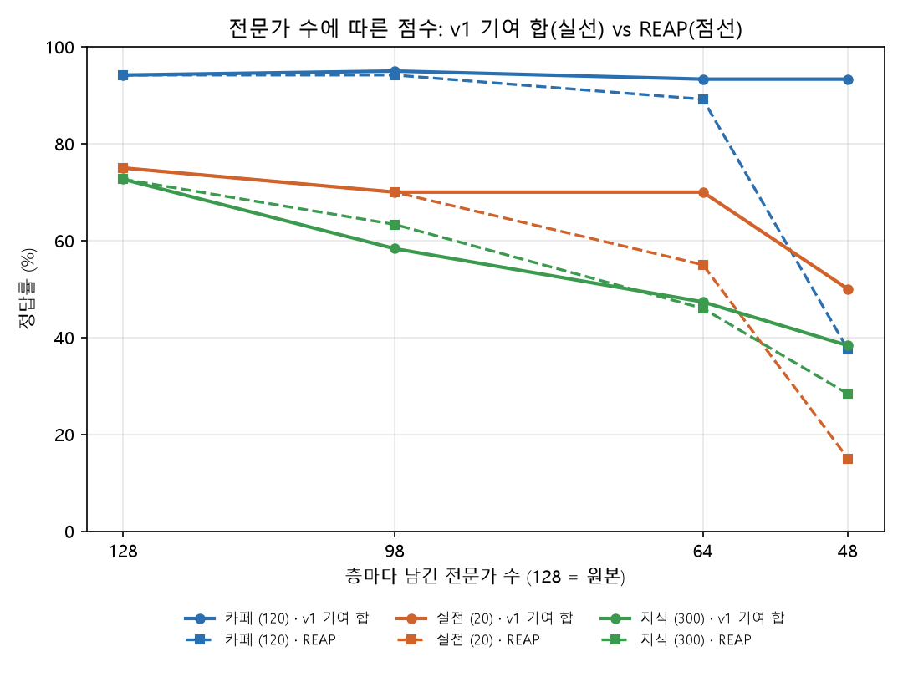

# REAP vs v1 기여 합: 크기별 곡선

- v1 기여 합 = v1 모델(50:50 가중 기여 합 + 바쁜 전문가 보호). REAP = 층마다 순수 REAP 상위 k개(v1 4b 계획). 모두 같은 원본·같은 변환·같은 Q4_K_M 텐서 형식, imatrix 없음, 같은 시험 설정(thinking 끔, temperature 0, seed 42).
- 원본은 Ollama `gemma4:26b`(CPU), 나머지는 iGPU. 엄격 = 공식 점수, 관대 = 되묻기 이유 코드만 무시.
- top-1 / KL: 보정 8문항(seed 7)의 문항 토큰 482개에서 HF 원본(float32) 마지막 logits와 비교. 원본은 기준이라 100% / 0. 참고로 원본을 BF16으로만 돌려도 92.5% / 0.103(`results/step5/validate_baseline_bf16.json`).

## 점수

| 모델 | 카페 (120) | 실전 엄격 (20) | 실전 관대 | 지식 (300) | top-1 일치 | KL | 빈 출력 (카페/실전/지식) |
|---|---:|---:|---:|---:|---:|---:|---:|
| 원본 128 | 94.2% | 75.0% | 75.0% | 72.7% | 100.0% | 0.000 | 0 / 0 / 0 |
| 98 · v1 기여 합 | 95.0% | 70.0% | 70.0% | 58.3% | 92.7% | 0.187 | 0 / 0 / 0 |
| 98 · REAP | 94.2% | 70.0% | 75.0% | 63.3% | 77.8% | 1.362 | 0 / 0 / 0 |
| 64 · v1 기여 합 | 93.3% | 70.0% | 70.0% | 47.3% | 80.3% | 0.912 | 0 / 0 / 0 |
| 64 · REAP | 89.2% | 55.0% | 70.0% | 46.0% | 73.2% | 1.769 | 0 / 0 / 0 |
| 48 · v1 기여 합 | 93.3% | 50.0% | 55.0% | 38.3% | 76.8% | 1.195 | 0 / 0 / 0 |
| 48 · REAP | 37.5% | 15.0% | 15.0% | 28.3% | 69.5% | 2.252 | 68 / 11 / 1 |

- 빈 출력 = 생성 길이 한도(num_predict)까지 가고도 도구 호출도 답도 없는 문항 수.
- 카페 관대 점수는 모든 모델에서 엄격과 같거나 거의 같아 `curve.json`에만 두었다.

## McNemar 정확 검정: REAP vs v1 기여 합 (같은 크기끼리)

| 크기 | 시험 | 채점 | REAP만 맞힘 | v1만 맞힘 | p | p < 0.05 | 보정 후 유의 |
|---:|---|---|---:|---:|---:|:-:|:-:|
| 98 | 카페 | 엄격 | 1 | 2 | 1.0000 |  |  |
| 98 | 카페 | 관대 | 1 | 2 | 1.0000 |  |  |
| 98 | 실전 | 엄격 | 1 | 1 | 1.0000 |  |  |
| 98 | 실전 | 관대 | 1 | 0 | 1.0000 |  |  |
| 98 | 지식 | 엄격 | 45 | 30 | 0.1053 |  |  |
| 98 | 카페 conditional (10) | 엄격 | 0 | 1 | 1.0000 |  |  |
| 64 | 카페 | 엄격 | 1 | 6 | 0.1250 |  |  |
| 64 | 카페 | 관대 | 1 | 6 | 0.1250 |  |  |
| 64 | 실전 | 엄격 | 2 | 5 | 0.4531 |  |  |
| 64 | 실전 | 관대 | 2 | 2 | 1.0000 |  |  |
| 64 | 지식 | 엄격 | 41 | 45 | 0.7465 |  |  |
| 64 | 카페 conditional (10) | 엄격 | 0 | 4 | 0.1250 |  |  |
| 48 | 카페 | 엄격 | 1 | 68 | 0.0000 | 예 | **예** |
| 48 | 카페 | 관대 | 1 | 68 | 0.0000 | 예 | **예** |
| 48 | 실전 | 엄격 | 1 | 8 | 0.0391 | 예 |  |
| 48 | 실전 | 관대 | 1 | 9 | 0.0215 | 예 |  |
| 48 | 지식 | 엄격 | 43 | 73 | 0.0068 | 예 |  |
| 48 | 카페 conditional (10) | 엄격 | 0 | 8 | 0.0078 | 예 |  |

- 보정 후 유의 = Bonferroni(검정 18번, p < 0.0028). 같은 문항에 채점만 다른 검정도 따로 세어 보수적이다.
- p < 0.05: 48|cafe|strict, 48|cafe|lenient, 48|live|strict, 48|live|lenient, 48|knowledge|strict, 48|cafe_conditional|strict
- 보정 후에도 유의: 48|cafe|strict, 48|cafe|lenient

## 카페 유형별 엄격 정답률

| 유형 | 원본 | 98 v1 | 98 REAP | 64 v1 | 64 REAP | 48 v1 | 48 REAP |
|---|---:|---:|---:|---:|---:|---:|---:|
| ambiguous | 70.0% | 70.0% | 70.0% | 70.0% | 70.0% | 70.0% | 0.0% |
| basic | 100.0% | 100.0% | 90.0% | 100.0% | 100.0% | 100.0% | 50.0% |
| call_staff | 100.0% | 100.0% | 100.0% | 100.0% | 90.0% | 100.0% | 60.0% |
| conditional | 100.0% | 100.0% | 90.0% | 90.0% | 50.0% | 90.0% | 10.0% |
| impossible | 100.0% | 100.0% | 100.0% | 100.0% | 100.0% | 100.0% | 40.0% |
| modify_cancel | 100.0% | 100.0% | 100.0% | 100.0% | 100.0% | 100.0% | 77.8% |
| multi_item | 100.0% | 100.0% | 100.0% | 100.0% | 100.0% | 100.0% | 33.3% |
| off_menu | 100.0% | 100.0% | 100.0% | 100.0% | 100.0% | 100.0% | 10.0% |
| options | 100.0% | 100.0% | 100.0% | 90.0% | 90.0% | 100.0% | 60.0% |
| slang | 100.0% | 100.0% | 100.0% | 100.0% | 100.0% | 100.0% | 80.0% |
| takeout | 60.0% | 70.0% | 80.0% | 70.0% | 80.0% | 60.0% | 40.0% |
| unavailable | 100.0% | 100.0% | 100.0% | 100.0% | 91.7% | 100.0% | 0.0% |
